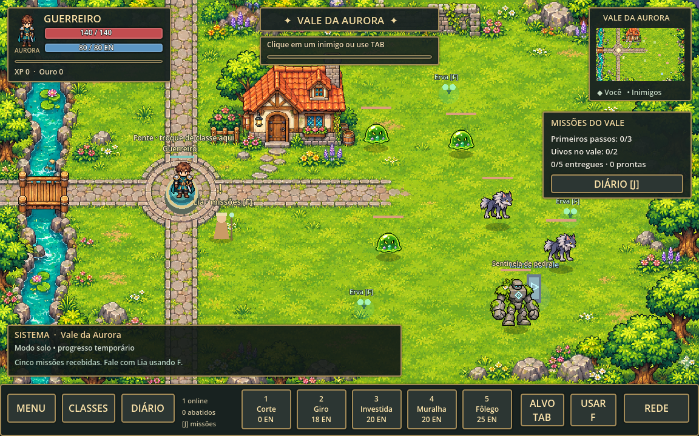

# Aurora — Fronteira Viva

Protótipo de RPG 2D cooperativo para PC e Android no Godot 4.6.3 padrão. Mundo e artes próprios; personagens, inimigos e fundo da vila foram gerados com IA. Não usa recursos extraídos do Warspear Online.



## Abrir e jogar

1. Instale o **Godot 4.6.3 padrão** (sem .NET).
2. No gerenciador de projetos, clique em **Importar** e selecione `project.godot`.
3. Aperte **F5** para iniciar. O jogo começa em modo solo junto à fonte.
4. Abra **CLASSES** para escolher guerreiro, maga ou patrulheira. É necessário estar perto da fonte e fora de combate.
5. Clique em um inimigo ou use **TAB**. Aproxime-se até o alcance da habilidade e ataque.

| Ação | PC | Toque |
| --- | --- | --- |
| Mover | WASD / setas | Direcional na tela |
| Selecionar inimigo | Clique / TAB | Toque no inimigo / ALVO |
| Ataque básico | Segurar Espaço / 1 | Segurar botão 1 |
| Habilidades | 2, 3, 4, 5 | Botões 2–5 |
| Interagir / coletar / entregar | F | USAR |
| Diário de missões | J / DIÁRIO | DIÁRIO |
| Trocar de classe | CLASSES junto à fonte | CLASSES junto à fonte |
| Fechar painel | Escape / × | × |

As barras mostram vida (vermelho), energia (azul) e experiência (dourado). Cada habilidade tem seu custo e sua recarga; o nome completo, os valores e a descrição aparecem na dica do botão. Nomes abreviados na barra evitam sobreposição. A fonte restaura vida e energia. Ao morrer, você retorna à fonte em três segundos e mantém o progresso da sessão.

## Classes e cinco habilidades por classe

Todas as quinze habilidades estão disponíveis desde o início, com execução e validação pelo servidor.

| Classe | 1 | 2 | 3 | 4 | 5 |
| --- | --- | --- | --- | --- | --- |
| Guerreiro | Corte: alvo próximo | Redemoinho: dano ao redor | Investida: avanço e golpe | Muralha: escudo | Fôlego: cura |
| Maga | Faísca: projétil arcano | Bola de fogo: explosão | Nova de gelo: dano e lentidão | Barreira: escudo | Tempestade: quatro pulsos em área |
| Patrulheira | Flecha: projétil rápido | Tiro duplo: duas flechas | Chuva: três ondas em área | Armadilha: dano e imobilização | Passo evasivo: recuo e esquiva |

O guerreiro tem 140 de vida / 80 de energia; a maga, 90 / 120; a patrulheira, 110 / 90. A energia regenera lentamente, mais rápido perto da fonte. Escudos duram até cinco segundos ou até serem consumidos. Trocar de classe mantém missões e recompensas, mas limpa habilidades e efeitos anteriores.

Ataques básicos procuram o inimigo mais próximo ao alcance quando nenhum alvo vivo está selecionado. Com um alvo selecionado, você precisa respeitar o alcance. O servidor rejeita habilidades sem energia, em recarga ou com a linha de visão bloqueada. Projéteis percorrem o cenário e colidem com paredes e inimigos; ataques básicos de corpo a corpo atingem um alvo, habilidades de área atingem vários.

## Colisões e inimigos

Rio, casa, rochas e massas principais de árvores têm máscaras de colisão ajustadas sobre a imagem do cenário. A ponte fica livre. Movimento, recuos e investidas usam subpassos para impedir atravessar paredes. Os inimigos também respeitam essas máscaras e usam caminhos em uma grade para contornar obstáculos. A fonte é uma área de cura acessível, não uma barreira.

Há três limos, dois lobos e uma sentinela de pedra. Cada espécie tem aparência, vida, velocidade, força e animação próprias. **Áreas vermelhas indicam onde o golpe vai cair**: saia delas antes do fim da preparação. O lobo é mais rápido e a sentinela tem um golpe maior e mais lento. Inimigos derrotados reaparecem após oito segundos. Não atacam dentro da zona segura da fonte.

## Cinco missões

As missões já começam no diário. **Lia**, perto da fonte, recebe as entregas com **F / USAR**. Cada missão concede XP e ouro uma única vez por jogador na sessão.

| Missão | Objetivo | Recompensa |
| --- | --- | --- |
| Primeiros passos | Derrotar 3 limos | 70 XP + 30 ouro |
| Uivos no vale | Derrotar 2 lobos | 100 XP + 50 ouro |
| Pedra desperta | Derrotar 1 sentinela | 150 XP + 75 ouro |
| Ervas do curandeiro | Coletar as 3 ervas luminosas | 75 XP + 40 ouro |
| Explorador do vale | Visitar o marco azul a sudeste | 50 XP + 25 ouro |

Além disso, inimigos dão XP e dois de ouro por abate. Ervas e progresso são individuais; dois jogadores podem cumprir a mesma missão. O ouro ainda é apenas uma recompensa acumulada: não há loja ou equipamentos compráveis.

## Multiplayer local

Abra **REDE → Hospedar** em uma instância. Na outra, abra **REDE**, informe o IP do anfitrião e clique em **Conectar**. Duas janelas no mesmo computador usam `127.0.0.1`; em Wi-Fi, use o IP local do anfitrião. Libere **UDP 24567** no firewall do anfitrião. O host pode receber até oito convidados; o teste automatizado usa um host e um cliente.

O servidor calcula colisões, projéteis, recursos, habilidades, dano e recompensas. Estado comprimido é enviado em um canal confiável separado; comandos de movimento usam mensagens não confiáveis com expiração. Esta é uma base de cooperação local, sem previsão de movimento, compensação de latência ou testes de carga. Não há servidor público, contas, persistência ou criptografia. Conexão pela internet depende de um host acessível e configuração de rede.

## Arte e animações

As folhas `assets/class_actions.png` e `assets/enemies.png` contêm poses de preparação, ataque e recuperação. Ataques têm efeitos de corte, gelo, fogo, raio, flechas, escudo, cura e números de dano. A caminhada do guerreiro tem quatro direções; maga e patrulheira usam pose própria com espelhamento e oscilação ao andar, ainda sem folhas completas de caminhada em quatro direções. Efeitos são desenhados pelo Godot e replicados pelo servidor.

O mapa continua sendo uma imagem de fundo, agora com colisões lógicas. Não há TileSet editável, interiores ou oclusão por camadas. As máscaras são aproximações de áreas sólidas, não recortes de cada pixel das árvores. Consulte [as notas da arte](assets/ART.md).

[Prévia do guerreiro](docs/class-warrior.png) · [Maga](docs/class-mage.png) · [Patrulheira](docs/class-ranger.png) · [Diário](docs/journal.png) · [Modo toque](docs/interface-touch.png)

## Android

O projeto usa renderização Compatibility, orientação horizontal e controles simultâneos de movimento e habilidades. Para conferir a interface no PC: `godot --path . -- --touch-ui`. A proporção é preservada; telas largas podem mostrar barras laterais.

Para exportar APK, instale os templates correspondentes ao Godot 4.6.3 e configure Java 17 e SDK Android conforme a documentação oficial do Godot. Adicione um preset Android em **Projeto → Exportar** e habilite a permissão **Internet**. APK, controles físicos em aparelho e desempenho Android **ainda não foram validados** nesta entrega.

## Desenvolvimento e testes

```sh
# Importe as texturas na primeira execução após clonar:
godot --headless --editor --import --path . --quit
godot --path .
godot --headless --path . --script tests/combat_test.gd
godot --headless --path . --script tests/ui_test.gd
python3 tests/network_smoke.py
# Servidor local, quando necessário:
godot --headless --path . -- --server
# Visualizar as máscaras de colisão:
godot --path . -- --debug-collisions
```

`COMBAT_PASS` valida as quinze habilidades, custo/recarga, colisões, ponte, projéteis, linha de visão, desvios de ataques, caminhos, missões, recompensas únicas, morte e troca de classe. `UI_PASS` valida controles, conteúdo das três classes e cinco missões, transparência, animação, barras e seleção de alvo. `NETWORK_PASS` inicia processos ENet reais, testa movimento, mudança de classe e habilidade especial replicadas e encerra apenas o servidor criado para o teste.

Ambientes restritos podem precisar de rede local autorizada e diretórios graváveis: `XDG_DATA_HOME=/tmp/aurora-data XDG_CONFIG_HOME=/tmp/aurora-config XDG_CACHE_HOME=/tmp/aurora-cache`. Processos devem ser reiniciados em uma nova tarefa.

Este é um protótipo jogável em evolução, ainda sem contas, salvamento, inventário, progressão de níveis, áudio ou mundo persistente de MMORPG.
