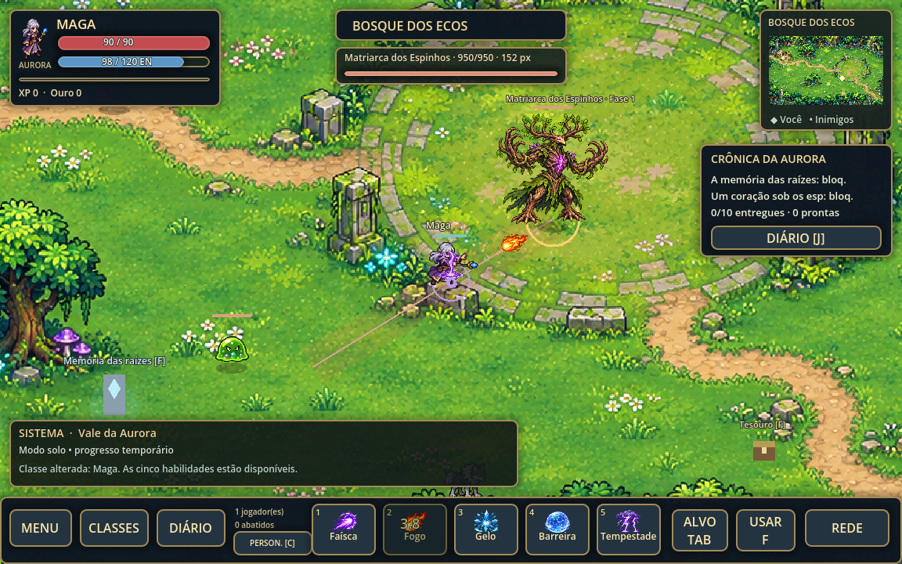
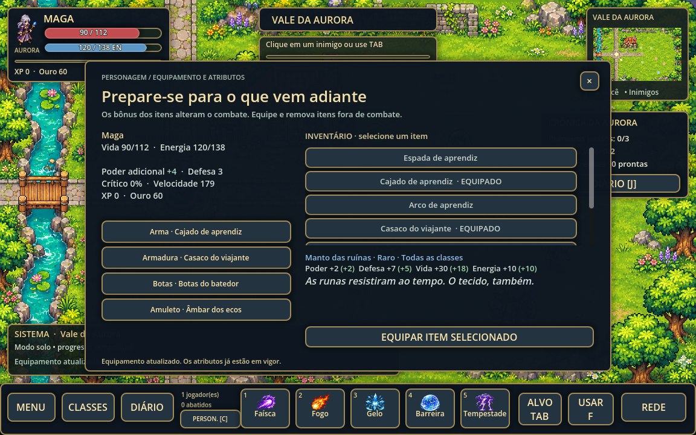
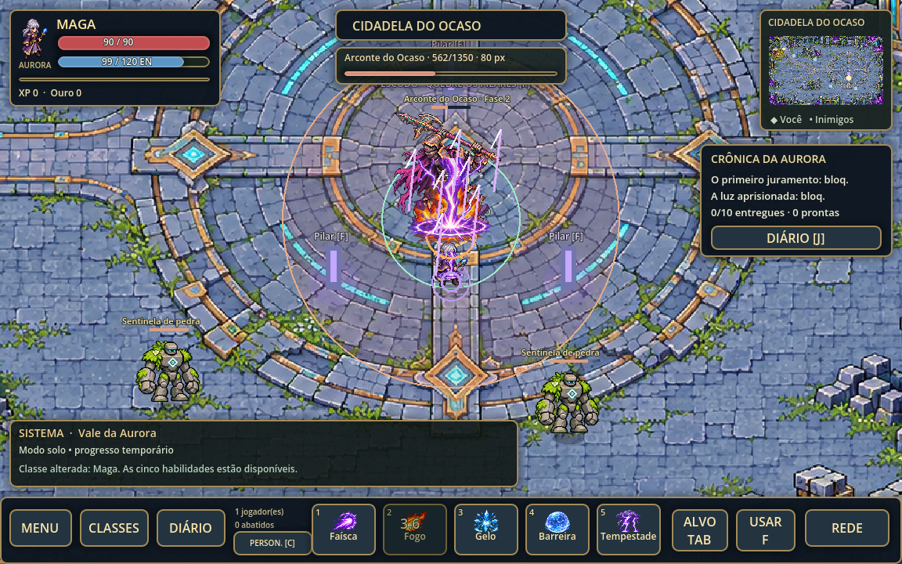

# Aurora — Fronteira Viva

Protótipo de RPG 2D cooperativo para PC e Android no Godot 4.6.3 padrão, agora com três regiões, uma história completa de abertura, equipamentos e dois chefes de área. Mundo e artes próprios; personagens, inimigos e fundo da vila foram gerados com IA. Não usa recursos extraídos do Warspear Online.


## Abrir e jogar

1. Instale o **Godot 4.6.3 padrão** (sem .NET).
2. No gerenciador de projetos, clique em **Importar** e selecione `project.godot`.
3. Aperte **F5** para iniciar. O jogo começa em modo solo junto à fonte.
4. Abra **CLASSES** para escolher guerreiro, maga ou patrulheira. É necessário estar perto da fonte e fora de combate.
5. Fale com **Lia usando F**, abra o baú dos viajantes e visite o marco azul a sudeste. Depois, siga ao portal leste para iniciar a expedição.
6. Clique em um inimigo ou use **TAB**. Aproxime-se até o alcance da habilidade e ataque.

| Ação | PC | Toque |
| --- | --- | --- |
| Mover | WASD / setas | Direcional na tela |
| Selecionar inimigo | Clique / TAB | Toque no inimigo / ALVO |
| Ataque básico | Segurar Espaço / 1 | Segurar botão 1 |
| Habilidades | 2, 3, 4, 5 | Botões 2–5 |
| Interagir / coletar / entregar | F | USAR |
| Diário de missões | J / DIÁRIO | DIÁRIO |
| Personagem / equipamento | C / PERSON. | PERSON. |
| Trocar de classe | CLASSES junto à fonte | CLASSES junto à fonte |
| Fechar painel | Escape / × | × |

As barras mostram vida (vermelho), energia (azul) e experiência (dourado). Cada habilidade tem seu custo e sua recarga; o nome completo, os valores e a descrição aparecem na dica do botão. Nomes abreviados na barra evitam sobreposição. A fonte restaura vida e energia. Ao morrer, você retorna à fonte em três segundos e mantém o progresso da sessão.

## Mundo maior e exploração

| Região | Dimensão do mapa | O que encontrar |
| --- | --- | --- |
| Vale da Aurora | 1152 × 636 | Fonte, Lia, marco, ervas, baú e primeiros combates |
| Bosque dos Ecos | 2304 × 1272 | Acampamento de Rovan, santuário, tesouros, patrulhas e Matriarca |
| Cidadela do Ocaso | 2304 × 1272 | Memória de Íria, ruínas, equipamentos rúnicos e Arconte |

As duas novas regiões têm quatro vezes a área visual do vale original. A câmera acompanha o personagem dentro delas. O minimapa muda para a região atual e mostra os jogadores e inimigos que estão nela. As regiões são ligadas por **portais interativos [F]**, não por uma caminhada contínua pela borda.

Use **F / USAR** perto de portais, baús, NPCs, santuários, ervas e pilares do chefe. Há quatro baús de tesouro individuais, dois santuários de memória e três NPCs regionais. Os santuários abrem trechos da história; os baús concedem equipamentos e 15 de ouro uma única vez por jogador na sessão.



## História: A Última Aurora

A fonte que protege o vale está perdendo a luz. Cael, irmão de Lia, seguiu uma marca antiga até a floresta e desapareceu. A investigação revela que a corrupção não começou no bosque: surgiu de um juramento quebrado na cidadela. A Matriarca foi a primeira vítima, não a origem do mal.

O arco tem cinco trechos de diálogo, dez missões ao todo e um encerramento jogável: recuperar as duas ressonâncias dos chefes, reunir sua luz na fonte e entregar a última missão a Lia. A crônica pode ser relida pelo **MENU → CRÔNICA E HISTÓRIA**. Cada NPC e santuário revela a parte correspondente à jornada.

Rota sugerida:

1. Visite o marco azul do vale e entregue essa descoberta a um NPC.
2. Entre no bosque pelo portal leste, encontre Rovan e interaja com o santuário das raízes. Entregue a missão.
3. Prepare equipamentos e enfrente a Matriarca na clareira. Entregue sua missão.
4. Siga pelo portal no sudeste do bosque, encontre a memória da cidadela e entregue a descoberta.
5. Vença o Arconte e entregue sua missão. Retorne à fonte, use **F** para restaurá-la e fale com Lia para concluir o arco.

Os pré-requisitos aparecem pelo nome no diário. A exploração é livre; capítulos e recompensas narrativas respeitam as entregas anteriores. As cinco missões iniciais funcionam como atividades do vale; a visita ao marco conecta a expedição à história.

## Equipamentos e atributos

Abra **PERSON. [C]** para consultar vida, energia, poder adicional, defesa, crítico, velocidade, XP e ouro. Há **quatro espaços de equipamento**: arma, armadura, botas e amuleto. O inventário permite selecionar itens, ler sua história, comparar os bônus com o item equipado e equipar; clicar em um espaço equipado remove o item.

Há 14 definições de itens, incluindo armas próprias de cada classe, equipamentos comuns a todas, tesouros dos baús e relíquias dos chefes. Limos, lobos e sentinelas concedem um equipamento correspondente na primeira obtenção; a Matriarca concede o Coração do Bosque, o Arconte a Armadura da Aurora e a restauração da fonte concede o Selo da Última Aurora. Itens repetidos não duplicam no inventário.

Os atributos têm efeito real:

- **Poder** soma dano por acerto de habilidade; crítico aplica 1,5× ao dano.
- **Defesa** reduz o dano recebido antes do escudo, em 0,6 por ponto, até um mínimo de 1.
- **Vida e energia** aumentam os limites; equipar um item não cura nem repõe recursos.
- **Velocidade** altera o deslocamento, preservando as colisões.

Trocas são permitidas apenas fora de combate e com o personagem vivo. O servidor valida posse, espaço e classe. Trocar de classe equipa a arma inicial compatível e preserva os itens comuns e o inventário. O sistema ainda não possui loja, pilhas de itens, durabilidade ou alteração visual de cada peça no corpo do personagem.



## Movimento e apresentação

Personagens aceleram e freiam gradualmente. As três classes têm folhas de caminhada em quatro direções, com quadros guiados pela distância percorrida. Inimigos patrulham, fazem pequenas pausas, evitam se acumular, respeitam a distância de combate e retornam à área de origem. A renderização interpola posições dos personagens, inimigos e projéteis entre estados de rede; as colisões continuam sendo calculadas no servidor.

Isso reduz a rigidez da versão anterior, mas ainda não é um sistema de animação final: inimigos comuns usam ciclos curtos de duas poses para deslocamento, e ataques de classe ainda usam a direção diagonal com espelhamento. Não há previsão de movimento local nem compensação de latência.

## Classes e cinco habilidades por classe

Todas as quinze habilidades estão disponíveis desde o início, com execução e validação pelo servidor.

| Classe | 1 | 2 | 3 | 4 | 5 |
| --- | --- | --- | --- | --- | --- |
| Guerreiro | Corte: alvo próximo | Redemoinho: dano ao redor | Investida: avanço e golpe | Muralha: escudo | Fôlego: cura |
| Maga | Faísca: projétil arcano | Bola de fogo: explosão | Nova de gelo: dano e lentidão | Barreira: escudo | Tempestade: quatro pulsos em área |
| Patrulheira | Flecha: projétil rápido | Tiro duplo: duas flechas | Chuva: três ondas em área | Armadilha: dano e imobilização | Passo evasivo: recuo e esquiva |

O guerreiro tem 140 de vida / 80 de energia; a maga, 90 / 120; a patrulheira, 110 / 90. A energia regenera lentamente, mais rápido perto da fonte. Escudos duram até cinco segundos ou até serem consumidos. Trocar de classe mantém missões e recompensas, mas limpa habilidades e efeitos anteriores.

Ataques básicos procuram o inimigo mais próximo ao alcance quando nenhum alvo vivo está selecionado. Com um alvo selecionado, você precisa respeitar o alcance. O servidor rejeita habilidades sem energia, em recarga ou com a linha de visão bloqueada. Projéteis percorrem o cenário e colidem com paredes e inimigos; ataques básicos de corpo a corpo atingem um alvo, habilidades de área atingem vários.

## Colisões e inimigos

Rio, casa, rochas e massas principais de árvores têm máscaras de colisão ajustadas sobre a imagem do cenário. A ponte fica livre. Movimento, recuos e investidas usam subpassos para impedir atravessar paredes. Os inimigos também respeitam essas máscaras e usam caminhos em uma grade para contornar obstáculos. A fonte é uma área de cura acessível, não uma barreira.

No vale há três limos, dois lobos e uma sentinela de pedra; as novas regiões acrescentam patrulhas e dois chefes, totalizando 17 inimigos iniciais. A Matriarca pode convocar mais dois lobos durante sua segunda fase. Cada espécie tem aparência, vida, velocidade, força e animação próprias. **Áreas vermelhas indicam onde o golpe vai cair**: saia delas antes do fim da preparação. O lobo é mais rápido e a sentinela tem um golpe maior e mais lento. Inimigos comuns derrotados reaparecem após oito segundos; chefes reaparecem após 60 segundos. Reforços da Matriarca desaparecem ao fim do encontro e seus espaços são reutilizados. Não atacam dentro da zona segura da fonte.

## Chefes com mecânicas diferentes

**Matriarca dos Espinhos — Bosque dos Ecos:** avisa antes de lançar linhas de espinhos; alterne sua posição para sair da faixa. Depois deixa poças de esporos que causam dano periódico. Abaixo de metade da vida, cria uma segunda linha e chama dois lobos uma vez por encontro. Ela perde interesse se você sair de sua área e recupera a vida ao retornar à clareira.

**Arconte do Ocaso — Cidadela:** alterna ondas em anel e três meteoros marcados. No anel, o centro e a parte externa são seguros. Abaixo de metade da vida, cria três pilares: enquanto qualquer um estiver ativo, recebe apenas 20% do dano. Aproxime-se de cada pilar e use **F** para desativá-lo. O aviso das áreas representa onde o dano realmente é calculado.

Os chefes resistem a imobilizações longas. Seus perigos desaparecem quando são derrotados. A dificuldade e os números ainda precisam de testes de balanceamento com jogadores.



## Missões do vale e capítulos

As dez missões aparecem no diário, com pré-requisitos para os capítulos da expedição. **Lia**, **Rovan** e a **Memória de Íria** recebem as entregas no acampamento de sua região com **F / USAR**. Cada missão concede XP e ouro uma única vez por jogador na sessão.

| Missão | Objetivo | Recompensa |
| --- | --- | --- |
| Primeiros passos | Derrotar 3 limos | 70 XP + 30 ouro |
| Uivos no vale | Derrotar 2 lobos | 100 XP + 50 ouro |
| Pedra desperta | Derrotar 1 sentinela | 150 XP + 75 ouro |
| Ervas do curandeiro | Coletar as 3 ervas luminosas | 75 XP + 40 ouro |
| Explorador do vale | Visitar o marco azul a sudeste | 50 XP + 25 ouro |

A sequência narrativa acrescenta A Memória das Raízes, Um Coração sob os Espinhos, O Primeiro Juramento, A Luz Aprisionada e A Próxima Manhã. Os diálogos, objetivos e recompensas estão detalhados no diário.

Além disso, inimigos dão XP e dois de ouro por abate. Jogadores vivos que contribuíram com dano nos últimos 15 segundos e continuam a até 650 unidades recebem crédito e tesouro individual. Ervas, baús e entregas são individuais e as recompensas não podem ser repetidas. Ouro e XP ainda não compram itens nem concedem níveis nesta versão.

## Multiplayer local

Abra **REDE → Hospedar** em uma instância. Na outra, abra **REDE**, informe o IP do anfitrião e clique em **Conectar**. Duas janelas no mesmo computador usam `127.0.0.1`; em Wi-Fi, use o IP local do anfitrião. Libere **UDP 24567** no firewall do anfitrião. O host pode receber até oito convidados; o teste automatizado usa um host e um cliente.

O servidor calcula colisões, projéteis, recursos, habilidades, dano e recompensas. Estado comprimido é enviado em um canal confiável separado; comandos de movimento usam mensagens não confiáveis com expiração. Esta é uma base de cooperação local, sem previsão de movimento, compensação de latência ou testes de carga. Não há servidor público, contas, persistência ou criptografia. Conexão pela internet depende de um host acessível e configuração de rede.

## Arte e animações

As folhas `assets/class_actions.png` e `assets/enemies.png` contêm poses de preparação, ataque e recuperação. Ataques têm efeitos de corte, gelo, fogo, raio, flechas, escudo, cura e números de dano. As três classes usam folhas de caminhada em quatro direções. O atlas `assets/skill_atlas.png` fornece quinze ícones de habilidade e cinco sprites de efeitos, também usados em projéteis e impactos. Efeitos são desenhados pelo Godot e replicados pelo servidor.

Os três mapas são fundos ilustrados com colisões lógicas e objetos interativos sobrepostos. Não há TileSet editável, interiores ou oclusão por camadas. As máscaras são aproximações de áreas sólidas, não recortes de cada pixel das árvores. Consulte [as notas da arte](assets/ART.md).

[Prévia do guerreiro](docs/class-warrior.png) · [Maga](docs/class-mage.png) · [Patrulheira](docs/class-ranger.png) · [Diário](docs/journal.png) · [Classes](docs/classes.png) · [História](docs/story.png) · [Cidadela](docs/ruins.png) · [Modo toque](docs/interface-touch.png)

## Android

O projeto usa renderização Compatibility, orientação horizontal e controles simultâneos de movimento e habilidades. Para conferir a interface no PC: `godot --path . -- --touch-ui`. A proporção é preservada; telas largas podem mostrar barras laterais.

Para exportar APK, instale os templates correspondentes ao Godot 4.6.3 e configure Java 17 e SDK Android conforme a documentação oficial do Godot. Adicione um preset Android em **Projeto → Exportar** e habilite a permissão **Internet**. APK, controles físicos em aparelho e desempenho Android **ainda não foram validados** nesta entrega.

## Desenvolvimento e testes

```sh
# Importe as texturas na primeira execução após clonar:
godot --headless --editor --import --path . --quit
godot --path .
godot --headless --path . --script tests/combat_test.gd
godot --headless --path . --script tests/ui_test.gd
godot --headless --path . --script tests/realms_test.gd
python3 tests/network_smoke.py
# Servidor local, quando necessário:
godot --headless --path . -- --server
# Visualizar as máscaras de colisão:
godot --path . -- --debug-collisions
```

`COMBAT_PASS` valida as quinze habilidades, custo/recarga, colisões, ponte, projéteis, linha de visão, desvios de ataques, caminhos, missões, recompensas únicas, morte e troca de classe. `UI_PASS` valida controles, conteúdo das três classes e dez missões, transparência, animação, barras e seleção de alvo. `REALMS_PASS` valida regiões e interações acessíveis, bônus e restrições de equipamentos, capítulos em ordem, fases dos chefes, anel seguro, pilares, reforços limitados, crédito cooperativo, restauração da fonte e interpolação. `NETWORK_PASS` inicia processos ENet reais, testa movimento, mudança de classe, habilidade especial, equipamento e passagem de portal replicados e encerra apenas o servidor criado para o teste.

Ambientes restritos podem precisar de rede local autorizada e diretórios graváveis: `XDG_DATA_HOME=/tmp/aurora-data XDG_CONFIG_HOME=/tmp/aurora-config XDG_CACHE_HOME=/tmp/aurora-cache`. Processos devem ser reiniciados em uma nova tarefa.

Este é um protótipo jogável em evolução, ainda sem contas, salvamento, progressão de níveis, áudio ou mundo persistente de MMORPG. O inventário e o progresso são mantidos apenas durante a sessão.
