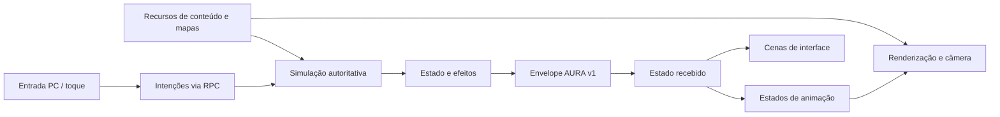

# Arquitetura do Aurora — primeira migração

Esta implementação adapta princípios dos documentos enviados pelo usuário (`ARCHITECTURE.md`, `CLIENT_ARCHITECTURE.md`, `DATA_MODEL.md`, `GAME_SYSTEMS.md`, `ART_FORMATS.md`, `DT_AND_MAP_FORMATS.md`, `NETWORK_PROTOCOL.md` e `GAPS_AND_UNKNOWNS.md`). Os anexos descrevem uma análise parcial de outro cliente; não são código-fonte ou especificações completas. A implementação, os IDs, as regras e os recursos do Aurora são próprios.

## Limites entre camadas

`world.gd` coordena os módulos, a cena e os RPCs. Suas funções públicas antigas delegam às novas implementações para preservar os fluxos e testes existentes. O estado de sessão continua no coordenador; as regras foram separadas:

| Módulo | Responsabilidade |
| --- | --- |
| `simulation/combat_system.gd` | Alvos, habilidades, dano, cura, escudos e troca de classe |
| `simulation/projectile_system.gd` | Disparo, trajeto, colisão e impacto |
| `simulation/effects_system.gd` | Áreas persistentes, eventos visuais e mensagens |
| `simulation/actors_system.gd` | Movimento, recursos, morte, reaparecimento e IA comum |
| `simulation/quests_system.gd` | Coleta e entrega de missões |
| `simulation/inventory_system.gd` | Posse, equipamento, atributos e tesouros |
| `simulation/boss_system.gd` | Fases, perigos, pilares e reforços |
| `network/session_transport.gd` | Aplicação de snapshots, validação de entrada e contadores |
| `presentation/animation_controller.gd` | Estado lógico e seleção de pose, sem calcular dano |
| `presentation/panel_scenes.gd` | Ligação dos sinais das cenas de UI às ações |
| `maps/map_registry.gd` | Dados das cenas, geometria compartilhada, objetos e chunks |

`realm_system.gd`, `game_data.gd` e `realm_data.gd` mantêm interfaces de compatibilidade. Os registros de classes, habilidades, itens, missões e inimigos deixaram de ser grandes constantes nesses arquivos.

## Conteúdo compartilhado por recursos

`content/game_catalog.tres` contém 47 registros originais: 3 classes, 15 habilidades, 14 itens, 10 missões e 5 tipos de inimigo. Cada registro usa `content_entry.gd`, com ID estável, categoria e dados. Exemplos:

- `class.mage`
- `skill.mage.fireball`
- `item.dawn_sigil`
- `quest.restore`
- `enemy.boss_ruins`

Referências entre registros usam IDs. A camada de compatibilidade traduz classes/slots/pré-requisitos para os índices usados pela simulação atual. Esses índices permanecem explícitos e devem ser preservados; adicionar novos comportamentos ainda exige implementá-los no módulo correspondente.

O catálogo valida IDs duplicados, campos obrigatórios, números inválidos, slots, chances de crítico, referências e pré-requisitos fora de ordem. Cada classe precisa de cinco habilidades. A inicialização do jogo e `tools/validate_content.gd` verificam o conteúdo. Dados inválidos impedem uma inicialização anunciada como válida.

## Mapas nativos, camadas e navegação

`content/maps/manifest.tres` referencia as três cenas de região. Cada cena é a fonte de suas dimensões, limites navegáveis, imagem, polígonos e marcadores. O editor Godot permite mover os objetos e editar a geometria diretamente. Não há uma segunda lista de posições de monstros ou retângulos de colisão no código de gameplay.

Camadas: `Background`, `Terrain`, `Decoration`, `CollisionTiles`, `Collision`, `Objects` e `Foreground`. A pintura em `Terrain` usa a propriedade de tile `blocked`; a camada `CollisionTiles` bloqueia qualquer célula pintada. Decoração e primeiro plano são visuais. O registro lê a mesma geometria para movimento, linha de visão e grade AStar. O minimapa também apresenta as sobreposições pintadas.

A navegação usa células de 16 unidades agrupadas em chunks de **28 × 28 células**, uma escolha de organização inspirada nos anexos. Nosso cache utiliza flags próprias: `WALKABLE = 1`, `BLOCKED = 2`. Isso não interpreta nem presume o significado dos flags do `.map` original. Polígonos que cruzam uma fronteira são indexados nos chunks dos dois lados.

As regiões ainda são carregadas juntas, e os fundos ilustrados permanecem como camada base. Esta etapa não converteu toda a pintura em tiles nem implementou streaming de mapas. A paleta inicial de três pincéis reaproveita pequenos recortes de nossa própria arte para permitir edição incremental.

## Animação por estados

`content/animations/manifest.tres` referencia oito perfis: três classes e cinco inimigos. Cada perfil define dimensões, ponto de apoio dos pés, atlas, grade, quadros, duração, direção e espelhamento. Os estados explícitos são `idle`, `walk`, `prepare`, `attack`, `recover` e `dead`.

O controlador seleciona o estado a partir dos resultados da simulação. A caminhada avança pela distância percorrida; clips temporais suportam durações diferentes por quadro. O renderizador consome a pose selecionada e não define as regras de acerto. A morte é um estado disponível, mas o desenho atual ainda oculta personagens mortos durante o reaparecimento.

## Interface declarativa

As janelas de diário, classes, menu, história, personagem e rede são cenas `.tscn` em `content/ui/`. Layout, estilos, imagens e controles podem ser editados no Godot. `panel_scenes.gd` conecta sinais e resolve os nós pelo nome; dados variáveis continuam sendo preenchidos em runtime. Inventário e cartões de missão apresentam o estado recebido.

O HUD principal e os controles de toque ainda são montados por código. PC e Android compartilham a proporção e o desenho atual; não há um novo layout mobile independente nesta etapa.

## Rede própria e versionada

O transporte continua sendo ENet/UDP na porta 24567. O snapshot comprimido usa o seguinte envelope **próprio**, em little endian:

| Offset | Campo |
| --- | --- |
| 0 | 4 bytes ASCII `AURA` |
| 4 | versão `u16 = 1` |
| 6 | tipo `u16 = 1` (snapshot) |
| 8 | tamanho comprimido `u32` |
| 12 | corpo DEFLATE com serialização Variant do Godot |

O codec rejeita cabeçalhos truncados, versões e tipos desconhecidos e tamanhos incompatíveis. Compressão e descompressão são limitadas a 1 MiB. Objetos não são desserializados. `session_transport.gd` conta pacotes, bytes e rejeições. Os testes reais de host/cliente usam o novo caminho.

Esse formato não é SVP, não reproduz a rede do Warspear e não é um protocolo independente do Godot. Cliente e servidor devem usar a mesma versão. Autenticação, TLS, persistência e serviço público continuam fora desta primeira migração.

## Validação e próximos trabalhos

`tests/run_checks.py --network` executa validação de conteúdo, gameplay, UI, regiões, arquitetura e dois peers reais. O runner preserva falhas e também rejeita logs de erro do Godot, pois alguns erros de script podem ocorrer mesmo quando o processo retorna zero.

A sequência posterior pode evoluir a arte para um TileSet completo, retirar as interfaces de compatibilidade, separar mais painéis do HUD e preparar contas/servidor dedicado/banco. Nada disso é necessário para abrir e testar a entrega atual, e essas capacidades ainda não foram implementadas.
